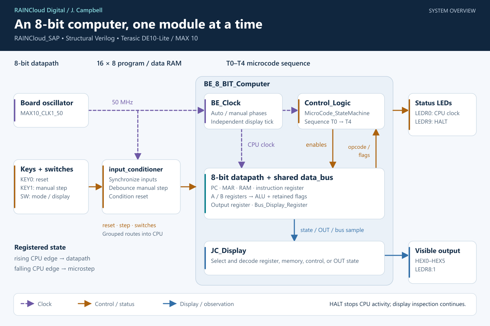
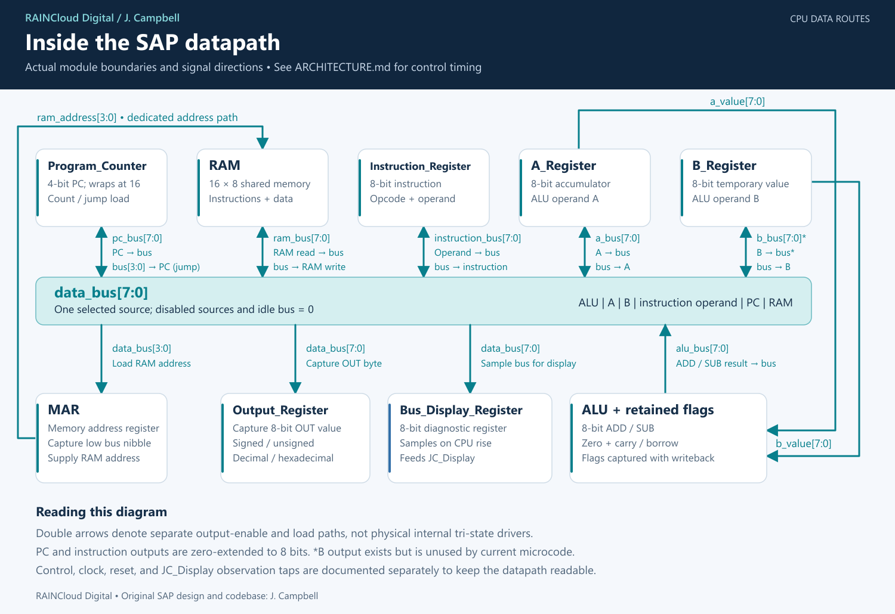

# SAP architecture

RAINCloud Digital | RAINCloud_SAP | J. Campbell

The SAP is an 8-bit stored-program computer built from registers, a small RAM,
an arithmetic unit, and a five-step controller. Instructions and data share
16 bytes of memory. A shared 8-bit bus moves values between modules; a separate
4-bit address path selects RAM locations.

These diagrams describe the active [RTL](rtl/), including the explicit FPGA
bus and retained arithmetic flags. The original schematic-export sources are
preserved separately in `reference/original`. The diagrams show logical module
connections; they are not a post-fit FPGA placement or timing diagram.

## System overview



[Open the scalable SVG](docs/images/sap-overview.svg).

[`RAINCloud_SAP`](rtl/RAINCloud_SAP.v) connects the DE10-Lite board to two
modules: `input_conditioner` and `BE_8_BIT_Computer`. The conditioner synchronizes
switches, debounces the manual-step key, and supplies reset with asynchronous
assertion and a board-clock-synchronized release. The 50 MHz oscillator runs
both the conditioner and `BE_Clock`.

Inside the CPU, `BE_Clock` provides complementary execution phases.
`Control_Logic` advances the microstep and uses `MicroCode_StateMachine` to
select bus sources and register loads. The instruction register supplies the
opcode; the ALU supplies retained flags for conditional branches. The controller's
`cpu_halt` signal feeds back to `BE_Clock` to stop CPU activity.

`JC_Display` observes the datapath and controller, then drives the six
seven-segment displays and diagnostic LEDs. The overview groups reset, switch,
status, and observation routes to keep it readable. In particular, the clock
and HALT status LEDs come directly from `cpu_clock` and `cpu_halt`, while the
control-word display and independent display tick enter `JC_Display` directly.

## Datapath and bus ownership



[Open the scalable SVG](docs/images/sap-datapath.svg).

The shared bus is the `data_bus[7:0]` net in
[`BE_8_BIT_Computer`](rtl/be_8_bit_computer.v):

```verilog
assign data_bus = alu_bus | a_bus | b_bus | instruction_bus | pc_bus | ram_bus;
```

Each FPGA-mode source drives zero when disabled. Microcode selects at most one
source at a time, and each architectural bus load requires exactly one source.
With no source selected, the bus is zero. The CPU testbench checks these rules.
This is ordinary gated FPGA logic; the double arrows in the diagram represent
separate load and output paths.

| Source module | Bus contribution | Output enable | Value when selected |
| --- | --- | --- | --- |
| `Program_Counter` | `pc_bus[7:0]` | `pc_output_enable` | Zero-extended 4-bit PC |
| `RAM` | `ram_bus[7:0]` | `ram_read_enable` | Byte at `ram_address` |
| `Instruction_Register` | `instruction_bus[7:0]` | `instruction_output_enable` | Zero-extended low instruction nibble (address operand) |
| `A_Register` | `a_bus[7:0]` | `a_output_enable` | Accumulator byte |
| `B_Register` | `b_bus[7:0]` | `b_output_enable` | B byte; this output is unused by the current microcode |
| `ALU` | `alu_bus[7:0]` | `alu_output_enable` | 8-bit addition/subtraction result |

The following destinations capture values on a rising `cpu_clock` edge:

| Destination | Capture control | Bus bits used |
| --- | --- | --- |
| A register | `a_load_enable` | All 8 |
| B register | `b_load_enable` | All 8 |
| Instruction register | `instruction_load_enable` | All 8: opcode in bits 7:4, operand in bits 3:0 |
| Memory address register (MAR) | `mar_load_enable` | Low 4 |
| Program counter (jump load) | `pc_jump_enable` | Low 4 |
| RAM write port | `ram_write_enable` | All 8, written at `ram_address` |
| Output register | `output_load_enable` | All 8 |
| Bus display sampler | `bus_display_enable` | All 8; samples zero instead when disabled |

[`Bus_Display_Register`](rtl/bus_display_register.v) is the **display sampler**.
The shared bus itself is the OR expression above. The sampler observes every
CPU rising edge because the current microcode keeps `bus_display_enable` high,
including idle microsteps. It has no reset input or RTL initializer: the first
CPU rising edge establishes its sample, and reset alone does not clear a
previously captured sample.

The module was originally named `Data_Bus`; its new name describes the stored
diagnostic value. Its sampled output travels on `bus_display` to the
`Bus_Display_Sample` input of `JC_Display`, which selects values and drives
the board displays.

Several paths bypass the shared bus:

- `a_value[7:0]` and `b_value[7:0]` continuously feed the ALU operands.
- MAR supplies `ram_address[3:0]` to RAM when `mar_output_enable` is high;
  otherwise the address output is zero. The stored MAR value is unchanged.
- `instruction_opcode[3:0]` goes to the controller. The dedicated
  `instruction_operand[3:0]` connection reaches the controller's legacy
  `OPERAND` port, which is unused; operand transfers use `instruction_bus`.
- `cpu_flags[7:0]` returns retained flags to the controller. Bit 0 is zero,
  bit 1 is ADD carry / SUB borrow, and bits 7:2 are zero.
- State and result taps go to `JC_Display` as listed below.

The PC increments modulo 16 when `pc_count_enable` is asserted. ALU results
wrap modulo 256. Flags capture at ADD/SUB writeback when `flags_write_enable`
is asserted, then remain available to later instructions until another
arithmetic writeback or reset.

## Clock, reset, and instruction timing

The board clock runs at 50 MHz. `BE_Clock` derives `cpu_clock` and its complement
`cpu_clock_n`; rising CPU edges execute datapath operations and falling CPU
edges advance `Control_Logic.MICRO_CNT`. Control therefore changes before the
next datapath capture. Reset selects T0 and clears the architectural registers
and flags. RAM contents survive reset; FPGA configuration reloads the
[initial RAM image](programs/ram_init.hex).

Automatic mode offers nominal 1, 2, 4, 8, 16, 32, and 64 Hz clocks, plus the
original 25 MHz fast mode. In manual mode, a debounced key press produces the
rising phase and release produces the falling phase. One complete press/release
executes one microstep. See [board controls](README.md#board-controls).

Every instruction uses T0 and T1 to fetch. Normal instructions then pass
through T2, T3, and T4, including any idle steps. The falling edge after T4
returns to T0. HLT and undefined opcodes halt at T2 decode, before its next
datapath capture; reset restarts the processor.

For example, `ADD address` moves data as follows:

| Step | Selected bus source | Operation on rising CPU edge | Purpose |
| --- | --- | --- | --- |
| T0 | PC | `MAR ← PC`; `PC ← PC + 1` | Address the instruction; MAR captures the old PC while PC advances |
| T1 | RAM | `IR ← RAM[MAR]` | Fetch the instruction byte |
| T2 | IR low nibble | `MAR ← IR[3:0]` | Address the operand |
| T3 | RAM | `B ← RAM[MAR]` | Load the second arithmetic operand |
| T4 | ALU | `A ← A + B`; capture zero and carry | Write back the result and retain its flags |

The execute steps for the complete instruction set are:

| Instruction | T2 | T3 | T4 |
| --- | --- | --- | --- |
| NOP | Idle | Idle | Idle |
| LDA | Operand → MAR | RAM → A | Idle |
| ADD | Operand → MAR | RAM → B | A + B → A; capture flags |
| SUB | Operand → MAR | RAM → B | A − B → A; capture flags |
| OUT | A → output register | Idle | Idle |
| JMP | Operand → PC | Idle | Idle |
| STA | Operand → MAR | A → RAM | Idle |
| JZ | Operand → PC if zero is set | Idle | Idle |
| JC | Operand → PC if carry/borrow is set | Idle | Idle |
| HLT / undefined | Halt on decode | Stopped | Stopped |

For opcode values, see the [instruction set](README.md#instruction-set).
The source of truth is [`microcode_statemachine.v`](rtl/microcode_statemachine.v).

## Display and observation paths

Display selection uses synchronized SW7:4. These are observation paths and do
not select a shared-bus source or modify stored CPU data.

| Selector | Core signal into `JC_Display` | Width | Meaning |
| --- | --- | ---: | --- |
| 0 | — | — | Blank |
| 1 | `a_display` | 8 | Stored A register |
| 2 | `b_display` | 8 | Stored B register |
| 3 | `alu_result` | 8 | Current combinational ALU result |
| 4 | `cpu_flags` | 8 | Retained zero and carry/borrow flags |
| 5 | `mar_display` | 4 | Stored MAR, independent of its output enable |
| 6 | `ram_display` | 8 | RAM byte at the currently driven `ram_address` |
| 7 | `pc_value` | 4 | Stored PC |
| 8 | `output_display` | 17 | OUT sign symbol and three digit slots; only two slots are shown in hex mode |
| 9 | `bus_display` | 8 | Last sample taken by `Bus_Display_Register` |
| A | `control_word` | 16 | Diagnostic control bits |
| B | `instruction_display` | 8 | Full stored instruction |
| C–F | — | — | Blank |

`Output_Register` stores the raw OUT byte and formats it combinationally.
SW8 selects signed interpretation; SW9 selects hexadecimal instead of decimal
magnitude. Display choices and output-format changes continue to work during
HALT because input conditioning and combinational display logic remain active.

The same hexadecimal mode signal also reaches `JC_Display.CPU_Output_Hexadecimal`.
In the C (OUT) view, it blanks HEX2 when hexadecimal is selected, leaving the
two digits on HEX1:HEX0. Decimal displays all three digits on HEX2:HEX0, including
leading zeros. HEX5 remains C, HEX4 remains blank, and HEX3 retains the existing
sign/blank position. Other diagnostic views are unaffected by this mode signal.

The independent `display_clock` from `BE_Clock` alternates the two bytes of
`control_word` on LEDR8:1 when the control view is selected. At 50 MHz it changes
phase every 2.5 seconds (0.2 Hz full cycle). It is not a digit-scanning clock;
the six HEX outputs are driven directly by combinational decoders. Decimal
points remain off. LEDR0 shows `cpu_clock`, and LEDR9 shows `cpu_halt`.

`control_word[15:0]` contains the following diagnostic bits, from high to low:

```text
15 OUT load     14 MAR enable  13 MAR load  12 IR load
11 IR output   10 RAM write    9 RAM read   8 B load
 7 B output     6 flags write  5 subtract   4 ALU output
 3 A load       2 A output     1 PC output  0 PC count
```

HALT, jump, and bus-display enable are separate control signals and are not
included in this 16-bit word.

## Module map

The active source list contains 21 module types. Instance names below match
the RTL, so a reader can follow the diagrams into the implementation.

| Module / source | Instance and parent | Responsibility |
| --- | --- | --- |
| [`RAINCloud_SAP`](rtl/RAINCloud_SAP.v) | Top level | DE10-Lite board wiring |
| [`input_conditioner`](rtl/input_conditioner.v) | `inputs` in top level | Switch synchronization, step debounce, reset conditioning |
| [`BE_8_BIT_Computer`](rtl/be_8_bit_computer.v) | `cpu` in top level | Core wiring and shared bus |
| [`BE_Clock`](rtl/be_clock.v) | `b2v_CLK` in core | Automatic/manual CPU phases and independent display tick |
| [`Control_Logic`](rtl/control_logic.v) | `b2v_CL` in core | Microstep register and control distribution |
| [`MicroCode_StateMachine`](rtl/microcode_statemachine.v) | `b2v_MSM` in control logic | Combinational instruction/microstep/flag decode |
| [`Program_Counter`](rtl/program_counter.v) | `b2v_PC` in core | Incrementing or jump-loaded 4-bit instruction address |
| [`Memory_Address_Register`](rtl/memory_address_register.v) | `b2v_MAR` in core | Stored 4-bit RAM address |
| [`RAM`](rtl/ram.v) | `b2v_RAM` in core | Shared 16 × 8 program/data store |
| [`Instruction_Register`](rtl/instruction_register.v) | `b2v_IR` in core | Instruction capture and opcode/operand split |
| [`A_Register`](rtl/a_register.v) | `b2v_AR` in core | Accumulator and direct ALU operand |
| [`B_Register`](rtl/b_register.v) | `b2v_BR` in core | Temporary arithmetic operand |
| [`ALU`](rtl/alu.v) | `b2v_ALU` in core | Addition/subtraction and retained flags |
| [`Output_Register`](rtl/output_register.v) | `b2v_OR` in core | OUT capture and numeric formatting |
| [`Bus_Display_Register`](rtl/bus_display_register.v) | `bus_display_register` in core | Bus display sample |
| [`JC_Display`](rtl/jc_display.v) | `b2v_DISP` in core | Display selection and segment decoding |
| [`IC_74LS173_RTL`](rtl/ic_74ls173_rtl.v) | Within A, B, IR, MAR, and ALU | 4-bit enabled registers, including retained flags |
| [`IC_74LS245AB_RTL`](rtl/ic_74ls245ab_rtl.v) | Within A, B, IR, MAR, ALU, and PC | Gated A-to-B buffer paths |
| [`IC_74LS245BA_RTL`](rtl/ic_74ls245ba_rtl.v) | Within PC | Gated B-to-A parallel-load path |
| [`IC_74LS283_RTL`](rtl/ic_74ls283_rtl.v) | Two cascaded instances within ALU | 4-bit adders forming the 8-bit arithmetic path |
| [`IC_74LS161_RTL`](rtl/ic_74ls161_rtl.v) | Within PC | 4-bit counter with parallel load |

The 74LS-style modules preserve the original structural teaching design.
Their primitive port names retain the legacy naming, while internal signals
use descriptive names. See [NET_NAMES.md](NET_NAMES.md) for conventions and
the original-to-current name mapping. Board boundaries and electrical/timing
contracts are recorded in [INTERFACES.md](INTERFACES.md).

## Maintaining these diagrams

[`scripts/draw_architecture.py`](scripts/draw_architecture.py) generates the two
SVGs with Python's standard library. Run it from the project root:

```powershell
python scripts/draw_architecture.py
```

The SVGs contain editable text, paths, and module boxes. After changing the
generator, export matching PNGs at the SVGs' native sizes (1440 × 960 for the
overview, 1500 × 1030 for the datapath). Commit the generator, SVGs, and PNGs
together. PNGs provide GitHub README previews; SVGs provide scalable copies.
The [image notes](docs/images/README.md) include a reproducible export command.

Keep bus sources, signal widths, clock phases, module names, and microsteps
aligned with the active RTL. [VALIDATION.md](VALIDATION.md) records the checks
and distinguishes simulation/fitted timing results from pending board tests.
