# SAP and SDRAM matrix accelerator exploration

RAINCloud Digital | RAINCloud_SAP | J. Campbell (Jerry Campbell)

2026-10-15 | Architecture proposal | `explore/ai-edge-accelerator`

Build toward a small **SDRAM-backed `Y = A × B + D` demonstration** on the
DE10-Lite. SAP provides the visible stored-program controller; a separate
multiply-accumulate engine processes matrices from on-chip scratchpads. SDRAM
holds inputs and results, with DMA moving blocks between SDRAM and scratchpads.

## Confirmed scope and proposed choices

The user selected a matrix multiply/add learning demo and explicitly requested
SDRAM use. The eventual AI workload remains open. This exploration uses the
existing DE10-Lite and SAP foundation, preserves the published baseline, and
remains local to the exploration branch. No new board or fabrication is involved.

The 4 × 4 dimensions, integer formats, one MAC lane, memory map, clock target,
and performance budgets below are **proposals for the experiment**, not selected
AI model requirements. Quantization/scaling, activation functions, model size,
final parallelism, cache policy and application performance targets remain open.

## Evidence and reuse boundary

| Item | Confirmed state and consequence |
| --- | --- |
| SAP baseline | Commit `5c68660ba5244cbdc1450fba62fa361590deac7e`; clean at inspection. Local `main` and `origin/main` resolve to it. Active RTL has an 8-bit bus, 4-bit PC/MAR, 16-byte RAM, and T0–T4 microcode. |
| CPU memory timing | RAM reads are combinational; writes occur on CPU rising edges. Microsteps advance on falling edges without a wait input. External memory cannot replace RAM by wiring ports alone. |
| SAP validation | Existing record reports all five Questa suites and Quartus 25.1 fit/timing pass, with nine documented build warnings. Structural check rerun for this exploration passed. SAP board validation is still pending. |
| SDRAM source | Read-only reference: `D:\RAINCloud\GitHub\SDRAM_Tester_Working`, branch `work/sdram-tester`, base `ed6d0eb7dd0a833e767ce2f699c9b9ae83219b81`. Supported implementation is `rtl/library/sdram_controller.sv`, version 1.2.1, firmware 26101404. The new implementation is uncommitted there. |
| SDRAM evidence | Saved release records report model/host regressions, fitted timing and a full 64 MiB hardware write/read test with zero comparison errors, at about 48.3 MB/s combined FPGA traffic. This is historical tester evidence, not a new board test or accelerator result. |
| Dependency identity | 30 of 31 current firmware/host/validation input hashes match the saved release manifest, including controller RTL, board RTL, PLL, timing constraints and host code. The QSF hash differs; reconcile it before claiming an exact release reproduction. See [inspection manifest](ai_edge_sources.json). |
| Tool migration | SDRAM evidence uses Quartus 23.1; SAP uses 25.1. Rebuild the combined project and regenerate/check JTAG IP under 25.1. Prior timing results do not establish combined-design timing. |

Relevant SAP sources: [core wiring](../rtl/be_8_bit_computer.v),
[microcode](../rtl/microcode_statemachine.v),
[microstep counter](../rtl/control_logic.v), [clock](../rtl/be_clock.v),
[RAM](../rtl/ram.v), [baseline architecture](../ARCHITECTURE.md) and
[validation](../VALIDATION.md). SDRAM evidence paths in the inspection manifest
are relative to the separate dependency repository; its source and records were
not modified or copied into the active SAP build.

## Proposed architecture

```mermaid
flowchart LR
    SAP["SAP teaching CPU"] <-->|"byte commands and status"| MB["SAP mailbox adapter"]
    MB <-->|"acknowledged command and result"| CTL["Accelerator registers and sequencer"]
    HOST["Python reference and host client"] <-->|"USB-Blaster / JTAG"| JTAG["Host registers and staging RAM"]
    JTAG <-->|"descriptor, start, status, counters"| CTL
    JTAG <-->|"host memory transactions"| ARB["Transaction arbiter"]
    CTL -->|"addresses, lengths, operation"| DMA["Burst DMA and packing"]
    DMA <-->|"request, data, completion"| ARB
    ARB <-->|"one outstanding transaction"| MEM["sdram_controller 1.2.1"]
    MEM <-->|"physical 16-bit data and commands"| SDRAM["64 MiB board SDRAM"]
    DMA <-->|"tile loads and result stores"| BUF["A, B, D and Y scratchpads"]
    BUF <-->|"operands and accumulated results"| MAC["MAC lane and matrix add"]
    CTL -->|"loop indices and enables"| MAC
```



Only SAP and `sdram_controller` already exist as reusable computation/memory
blocks. The connected accelerator, DMA, arbiter and SAP mailbox are new work.
The existing tester has JTAG registers and staging RAM, but its test-specific
`tester_regs` and Python `Tester` API are not an accelerator register map.
Reuse the transport pattern (`read32`, `write32`, `close`) and qualified memory
service, with a separately versioned accelerator client and register contract.

The sequencer needs descriptor validation, start/busy/done/error, a run ID,
latched dimensions/addresses and FPGA cycle counters. Start must capture a stable
descriptor; reject another start while busy. The MAC needs signed multiplication,
explicit product extension, accumulation, D addition and result writeback.
Separate A/B RAMs provide two operand reads; D/Y storage and RAM read latency
must be reflected in the schedule. Begin with one lane and one set of buffers.

Terasic lists 50K logic elements, 1,638 Kbits of M9K RAM and 144 18 × 18
multipliers for the [DE10-Lite](https://www.terasic.com.tw/cgi-bin/page/archive.pl?CategoryNo=235&Language=Taiwan&No=1059&PartNo=2).
These are device capacities, not available MAC throughput. Check actual multiplier
inference, M9K allocation and timing in the combined fit. The tester's recorded
7,111 logic elements and 72,192 memory bits include its tester/JTAG logic and
cannot be treated as the standalone controller cost.

## SDRAM contract and ownership

Use the current library interface, not the historical `src/rtl` AXI-like wrapper:

| Channel | Contract |
| --- | --- |
| Request | `req_valid/req_ready`, `req_write`, even 26-bit **byte** address, 11-bit `req_words` containing the actual count 1..1024 |
| Write | `w_valid/w_ready`, 16-bit data and active-high two-bit byte mask; exactly the requested number of beats |
| Read | `r_valid/r_ready`, 16-bit data, `r_last` on the final accepted beat |
| Completion | `done_valid/done_ready`, two-bit `done_error`; consume completion even if a rejected request produced no data |

Hold valid and payload until accepted. The arbiter retains its selected client
through the completion handshake and routes all four channels consistently.
There is one outstanding transaction and no response tags. A stalled client can
block other clients, so clients must finish accepted transfers. Refresh remains
the controller's responsibility, including during client stalls and SAP HALT.

The library buffers an entire write before accessing SDRAM and an entire read
before returning data. Its 1..1024-word logical request is split into physical
segments of at most 256 words and at row boundaries. A physical row is 2 KiB.
Keep the qualified 50 MHz, CL3 profile and board PLL/forwarded-clock arrangement
for the first integration. Recheck all SDRAM I/O constraints and clock crossings.

Initially use exclusive buffer ownership: host prepares A/B/D, relinquishes the
matrix regions, accelerator owns them until the final Y write completion, then
host reads Y. Status/counter reads remain available. No simultaneous host edits,
in-place output aliasing, caching or speculative access. Validate ranges using
widened arithmetic so end-address overflow cannot wrap into legal memory.

## What SAP needs

Keep matrix traffic off SAP's shared `data_bus[7:0]`. SAP supplies start/poll/read
instructions, single-step observability and an OUT result/status byte. A small
experimental mapping could reserve addresses E and F for command/status and a
selected result byte; this reduces ordinary RAM to 14 bytes in that variant.
The host initially supplies full-width descriptors. Baseline programs and the
unmodified 16-byte configuration remain separate from this experimental map.

Such a mailbox still requires deliberate request/acknowledgement handling.
For a general external-memory adapter, hold the memory microstep and inhibit
architectural side effects while pending; issue each request once, latch the
response, then retire the load/store once. Freezing only `MICRO_CNT` would repeat
register loads or writes on later rising edges. Fetch T1 and operand T3 need
completion handling; PC increment/jump and flag writes must also remain singular.
Manual press/release, HALT, reset and completion near either clock phase need tests.

Two implementation options remain: extend the existing two-phase controller with
explicit pending/retire control, or move execution to 50 MHz clock-enable pulses
that preserve the teaching phases. The latter is a broader primitive/controller
refactor. Select after a small interface simulation; do not gate clocks with
combinational busy/ready logic. Cross the CPU/service boundary with an acknowledged
mailbox or appropriate FIFO, holding multi-bit payload until acknowledged.

Widening MAR alone does not expand SAP's address space: PC, jump paths, four-bit
instruction operands, fetch sequencing and program encoding also constrain it.
Later options are byte-accessed address registers/bank windows, or a wider PC/MAR
and multi-byte ISA. Start with the mailbox; add uncached external CPU data access
before considering program fetch from SDRAM or a CPU cache. For byte access,
align the controller address down to a word, select the read lane using address
bit 0, and use `w_be=01` or `10` for stores; no read-modify-write is needed.

Keep SDRAM refresh and the accelerator clock running when SAP is halted or
single-stepped. Specify CPU-only versus whole-system reset explicitly. A service
reset cancels work, invalidates result ownership and waits for `initialized`;
SDRAM contents are not promised across reset. SAP's existing internal RAM reset
semantics remain documented separately. `Bus_Display_Register`, instance
`bus_display_register`, remains a diagnostic sampler feeding
`JC_Display.Bus_Display_Sample`; it is not the bus or an accelerator buffer.
It has no reset or RTL initializer, and its first CPU rising edge sets its sample.

## First demonstrable operation

Proposed arithmetic: 4 × 4 A and B with signed 8-bit elements, signed 16-bit D,
and exact signed 32-bit accumulation/output. This is an integer teaching profile,
not an AI quantization scheme. With four products the output range is
[-97,792, 98,303], so no rounding, saturation or overflow is required. Multiplication
must form the signed 16-bit product before sign extension into the accumulator.

Store every matrix in row-major order, without transposing B in SDRAM. Pack two
consecutive int8 elements per 16-bit word, earlier element in the low byte; store
int16/int32 values little-endian, with the low word first for int32. Scratchpad
addressing supplies B[k,j] locally; DMA does not fetch a new B element per MAC.

| Region | Proposed byte base | 4 × 4 payload | DMA words |
| --- | ---: | ---: | ---: |
| A | 0x1000 | 16 bytes | 8 read |
| B | 0x1800 | 16 bytes | 8 read |
| D | 0x2000 | 32 bytes | 16 read |
| Y | 0x2800 | 64 bytes | 32 write |

Reserve each 2 KiB region exclusively for the demo; check guard words immediately
before/after each payload. These are SDRAM byte addresses, independent of the
JTAG control-register address space. Only 128 payload bytes are needed, but using
SDRAM in the complete demo exercises the intended data path. Larger experiments
can reuse the regions; a 16 × 16 case needs 2,048 total payload bytes across them.

Host writes A/B/D and guards, verifies upload, and stages the descriptor. SAP
starts the operation through its mailbox, polls completion, and displays a result
byte. Python reads all 16 Y elements from SDRAM and compares them exactly with
the [software reference](../scripts/matrix_demo_reference.py). A host start path
allows memory/compute bring-up before the SAP adapter is ready.

Generate the software vectors without connecting to hardware:

```powershell
python scripts/matrix_demo_reference.py --self-test --output build/ai_edge/reference_vectors.json
```

The JSON includes A/B/D/Y values and their packed byte payloads. The reference
supports compatible dimensions up to 16 for later experiments; the generated
suite uses the proposed 4 × 4 profile. No host transport is invoked.

## Staged experiments and acceptance

| Stage | Deliverable | Exit evidence |
| --- | --- | --- |
| 0 — This exploration | Architecture, dependency hashes and executable software reference | Reference known-answer checks; proposed choices explicitly separated from user requirements |
| 1 — Arithmetic simulation | One MAC lane, synchronous scratchpads, sequencer and add operation | All reference vectors match, including signed extrema; exactly 64 MAC terms and 16 D additions per 4 × 4 job |
| 2 — SDRAM-backed engine | DMA, host staging, ownership and memory model integration; then combined Quartus build/board trial | Bit-exact readback, unchanged guards, one completion per request, reset/backpressure/error/refresh tests; fit/timing pass under 25.1 and measured board round trips |
| 3 — SAP-controlled demo | Experimental mailbox, byte status/result path and small SAP program | SAP starts/polls/displays while full output remains verified from SDRAM; manual/fast modes, HALT/reset and legacy CPU regressions pass |
| 4 — Scaling experiment | 16 × 16, tile loops, then optional ping-pong buffers and more MAC lanes | Compare measured compute/data stalls and throughput before choosing parallelism or a real AI workload |

The first complete **SAP demonstration includes stages 1–3 and SDRAM**. Stage 1
isolates arithmetic errors; it does not replace the SDRAM-backed milestone.

Proposed acceptance: zero mismatches across the reference's seven directed and
100 seeded random 4 × 4 vectors; zero guard corruption; error completion rather
than deadlock for invalid requests. Add DMA cases for odd int8 tails, 1/1024-word
requests, row/bank/end crossings, stalls on each channel and reset while pending.
The initial fixed-shape accelerator must reject unsupported dimensions/overlap
before issuing DMA. Repeat the integrated cases on hardware; do not infer board
success from model success. Confirm refresh spacing remains within 380 core cycles.

Instrument load, compute, store, arbitration/stall and total cycles, plus accepted
bytes and MAC count. For the first single-lane schedule, propose **compute <=256
cycles (5.12 us at 50 MHz)** and **start-to-final-store completion <=2,048 cycles
(40.96 us)** after initialization, with no competing host requests or injected
stalls. These are pass/fail design budgets to test, not measured or guaranteed
performance. Exclude host transfer, SAP polling and power-up initialization from
that device counter; report host wall time separately. Under injected stalls use
a bounded testbench watchdog, not the no-stall latency budget.

Report MAC/s as `64 × core_hz / measured_cycles`, naming whether cycles cover
compute or the whole job. The 48.3 MB/s SDRAM tester result is for long transfers;
the demo's short requests will have proportionally more overhead. The current
controller's sequential client/physical buffering gives an idealized 50 MB/s
service ceiling at 50 MHz; its physical data-only bus ceiling is 100 MB/s.
External ping-pong buffers can overlap computation with DMA, but do not remove
that internal buffering cost. Do not size an array from the physical ceiling.

## Review point

Frozen scope: existing board, SAP foundation, small learning demo, and SDRAM in
the complete milestone. Provisional: all experimental formats/interfaces/budgets
above. No accelerator RTL, source-list, pin, timing or baseline program changes
are included in this exploration. The next engineering step is stage 1 plus a
small SAP mailbox timing experiment, followed by SDRAM integration. Preserve
RAINCloud Digital/J. Campbell attribution, original hashes, vendor notices and
the existing license status in all subsequent work.
